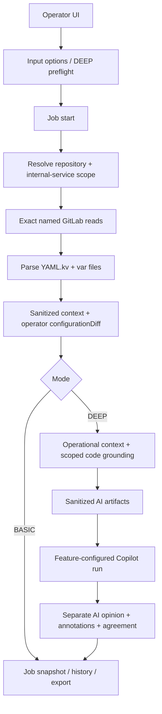

# Config Drift Viewer Runtime Flow

## Cel

Feature wykrywa rozjazd runtime configuration wybranego `internal-service`
pomiedzy branchami srodowiskowymi przed wdrozeniem. Operator dostaje:

1. deterministyczne fakty: coverage, diff i findings,
2. operatorska projekcje per plik z dokladnymi wartosciami source/target,
3. tylko w `DEEP`: oddzielna interpretacje AI, funkcjonalne znaczenie,
   code grounding i ownership/handoff,
4. jawne ograniczenia widocznosci i status kompletnosci.

Publiczny target joba to uporzadkowane `systemIds`. Configuration directory
jest rozstrzygany niezaleznie dla kazdego systemu z Operational Context, a
repozytorium konfiguracji z backendowej allowlisty.
Domyslna lista branchy to `dev`, `dev2`, `uat`, `uat2`. Lista prezentowana
przez input-options jest konfigurowana przez
`features.config-drift-viewer.branches` w
`application.properties`; glowny formularz i Tool Workbench korzystaja z tego
samego kontraktu opcji. Walidacja requestu dopuszcza bezpieczne nazwy refow Git,
z rodzin `dev`, `test`, `uat` i `zt`, opcjonalnie zakonczone wielocyfrowym
numerem. Brak sufiksu pozostaje dozwolony dla kazdej rodziny; domyslna lista
udostepnia bez sufiksu `dev` i `uat`.

## Publiczne wejscia

```http
GET  /api/config-drift-viewer/v1/input-options
GET  /api/config-drift-viewer/v1/deep-preflight
POST /api/config-drift-viewer/v1/jobs
GET  /api/config-drift-viewer/v1/jobs/{jobId}
POST /api/config-drift-viewer/v1/imports
```

Start joba przyjmuje tryb `BASIC` albo `DEEP`, repository id, niepusta liste
unikalnych `systemIds` oraz source/target branch. Kolejnosc listy jest
zachowana w snapshotach komponentow. `codeRef` i preferencje AI sa dozwolone
tylko dla `DEEP`. Connection id, GitLab project path, tokeny i configuration
directory nie sa swobodnym inputem klienta.

Named connection `runtime-config` bierze wartosci bazowe z
`integrations.gitlab.named.connections.runtime-config.base-url` oraz `token`.
Oba pola moga byc lokalnie nadpisane w Workspace Settings. Zapis aktualizuje
ten sam properties bean, ktory przy kazdym odczycie rozwiazuje
`GitLabNamedConnectionRegistry`, dlatego nowa wartosc obowiazuje bez restartu.

Podczas aktualnego rollout readiness glowny formularz operatorski pozwala
wybrac tylko `BASIC`. Opcja `DEEP` pozostaje widoczna jako disabled z badgem
`SOON`; publiczny kontrakt backendu, Workbench oraz renderowanie zapisanych i
importowanych wynikow `DEEP` pozostaja bez zmian.

Pole `Komponent / internal-service` jest rozwijanym multi-selectem. Po
zaladowaniu input-options wszystkie dostepne systemy sa zaznaczone. Operator
moze zaznaczyc albo wyczysc cala liste oraz zmieniac pojedyncze checkboxy;
pusty wybor blokuje start. Request zachowuje kolejnosc systemow z katalogu, a
historia i import odtwarzaja zapisane `systemIds`.

Wynik batcha jest prezentowany przez shared `AnalysisResultTabsComponent`.
Naglowek korzysta z paginacji Angular Material: po przekroczeniu szerokosci
strzalki odslaniaja kolejne nazwy bez scrollbara pod zakladkami. Strzalki
klawiatury i Home/End przesuwaja focus, Enter/Space wybieraja komponent.
Zakladki i rezultat sa na jednej powierzchni. Gotowy wynik ma jeden naglowek
nad plikami: kierunek porownania, liczba zmian/plikow, informacja o ograniczeniach,
Zmiany/Caly plik i Share. Nie powtarza nazwy aktywnej zakladki, statusow
technicznych ani osobnych naglowkow Configuration result / Roznice w plikach.
Kierunek pochodzi ze snapshotu diffu, nie z edytowanego formularza. Liczba plikow
obejmuje cale porownanie niezaleznie od filtra i liczby dokumentow YAML.
Kolumny FACT/AI zachowuja podzial merytoryczny bez osobnych kart. Aktywny panel
projekcji jest powiazany przez ARIA z wybrana zakladka, a shared aside
pozostaje poza karta i nadal otrzymuje dane tego samego komponentu.
Zakladki zachowuja kolejnosc `systemIds` i pokazuja nazwe komponentu bez
tekstowego sufiksu statusu. `QUEUED` i `RUNNING` maja mini loader;
`COMPLETED` nie ma wskaznika. `COMPLETED_WITH_LIMITATIONS` ma ikone info
z tooltipem zawierajacym opis stanu i `result.visibilityLimits`, a `FAILED`
ikone bledu z opisem `errorMessage`. Nazwa dostepna dla czytnika ekranu
zachowuje opis stanu; tooltip jest dostepny na hover i focus zakladki.
Aktualizacja snapshotu usuwa loader bez zmiany wybranego komponentu.
Aktywny panel renderuje jego wlasny diff plikowy, findings, report i przebieg
pracy. Blad jednego komponentu pozostaje lokalny dla jego zakladki i nie ukrywa
poprawnych wynikow pozostalych komponentow.

Page mapuje stan porownania i dostarcza go do naglowka renderera przez
projekcje `comparisonStatus`; `comparisonActions` zawiera shared Share.
Renderer nadal posiada wybor Zmiany/Caly plik i liczniki diffu. Tooltip
informacji na hover/focus zawiera komponent, repozytorium, tryb, przebieg,
ref kodu, liczniki ustalen/dokumentow/referencji, coverage stron i ograniczenia.
Niepelna lub brakujaca coverage oraz deterministyczny INCOMPLETE pokazuja
widoczne `Niepelne porownanie` niezaleznie od statusu zakonczenia runu.
Coverage w JSON zawiera `branch`, `branchExists` i `files`, bez pola
`complete`. UI wyznacza kompletnosc tak samo jak `BranchCoverage.complete()`:
branch istnieje, sa trzy oczekiwane pliki i wszystkie maja status AVAILABLE.
Ta sama ocena obowiazuje w naglowku, tooltipie i udostepnianym podsumowaniu.
Kompletne odczyty plikow nie uniewazniaja deterministycznego INCOMPLETE,
np. z powodu bledu parsowania albo nierozwiazanej referencji.
REVIEW_REQUIRED ma komunikat `Wymaga weryfikacji`. Przy kompletnej coverage
ograniczenia runu/AI sa opisane jako `Analiza z ograniczeniami`; trwajaca
analiza zachowuje loader w tabie i etap w tooltipie. Wynik bez ograniczen
pozostawia sama ikone informacji. Przed wynikiem i przy bledzie pozostaje
zwiezly kontekst branchy oraz dotychczasowa informacja o etapie lub bledzie.
Sekcja `Uwagi do porównania` jest widoczna tylko wtedy, gdy aktywny wynik
zawiera ustalenia. Zero ustalen ukrywa cala sekcje, licznik i filtr, bez zmiany
komunikatu o kompletnosci porownania. Jezeli ustalenia istnieja, ale filtr
waznosci nie zwraca dopasowan, sekcja i filtr pozostaja widoczne z komunikatem
`Brak ustalen dla wybranego filtra.`.

Feature-owned `config-drift-viewer-findings.presentation.ts` mapuje ustalenia
na czytelne tytuly, opisy, etykiety waznosci i lokalizacje. Ten sam mapper
zasila karty, BASIC Share i prezentacje sekcji `deterministic-findings`
raportu DEEP na ekranie oraz przy udostepnianiu. Prezentacja nie uruchamia AI
i nie modyfikuje zapisanego raportu, kontraktu findings ani eksportu JSON V1.
Kody i identyfikatory pozostaja w danych diagnostycznych i opcjonalnych
metadanych; glowna tresc uwag oraz etykiety odnosnikow ich nie pokazuja.

Opis coverage wynika z faktycznego statusu pliku albo brancha, a nie z samego
statusu INCOMPLETE. Uwaga parsera korzysta z zapisanego pliku, linii i klucza;
nieobslugiwana skladnia jest ograniczeniem analizatora, nie dowodem bledu
konfiguracji. Nierozwiazane odwolania i cykle wskazuja dotkniete srodowisko,
parametr oraz plik odnaleziony przez role i indeks dokumentu. Informacja o
wartosci wrazliwej nie zawiera jej wartosci ani tokenu. Brak lokalizacji lub
nieznany kod prowadzi do jawnego, neutralnego komunikatu bez zgadywania
przyczyny. Opisy wskazuja wplyw na porownanie i co nalezy sprawdzic.

## Przeplyw wspolny



Parent job publikuje postep calego batcha, a kazdy component snapshot publikuje
wlasne kroki `SOURCE`, `PARSE`, `DIFF`, opcjonalne `OPERATIONAL_CONTEXT`,
`CODE_GROUNDING`, `OWNERSHIP` oraz `AI`. Komponenty wykonuja sie rownolegle na
feature-owned executorze z konfigurowalnym limitem, domyslnie `20`. Awaria
jednego komponentu nie zatrzymuje pozostalych. Snapshot jest dostepny od stanu
`QUEUED`, zachowuje kolejnosc `systemIds` i jest utrwalany bez nakladajacych
sie zapisow.

## Tool Workbench

Readonly ekran `GET /config-drift-viewer-tools` pozwala sprawdzic ten sam
pipeline dla jednego repozytorium, jednego `internal-service` i jednej pary
branchy bez tworzenia joba, historii, eksportu ani sesji AI. `BASIC` nie
wywoluje zaleznosci DEEP; `DEEP` reuse'uje preflight, Operational Context,
code-search scope i ownership.

Workbench uzywa feature-owned API:

```http
POST /api/config-drift-viewer/v1/workbench/preview
GET  /api/config-drift-viewer/v1/workbench/preview/{previewId}/source
GET  /api/config-drift-viewer/v1/workbench/preview/{previewId}/configuration-diff
GET  /api/config-drift-viewer/v1/workbench/preview/{previewId}/mapping
GET  /api/config-drift-viewer/v1/workbench/preview/{previewId}/anonymization
GET  /api/config-drift-viewer/v1/workbench/preview/{previewId}/deep
GET  /api/config-drift-viewer/v1/workbench/preview/{previewId}/ai-input
GET  /api/config-drift-viewer/v1/workbench/preview/{previewId}/artifact
```

Pierwsza odpowiedz jest summary-first: zawiera `previewId`, `expiresAt`, scope,
liczniki, metadata artefaktow i visibility limits, ale nie materializuje
mappingu, decyzji anonimizacji, promptu ani tresci artefaktow. Sanitizowany
snapshot jest przechowywany w pamieci przez 10 minut, maksymalnie 32 wpisy;
wygasly albo usuniety identyfikator zwraca bezpieczne 404 bez odczytu GitLaba.
Zakladki pobieraja dane leniwie z tego samego snapshotu, wiec nie powtarzaja
source acquisition. Mapping i anonimizacja sa stronicowane z limitem do 200
elementow; mapping domyslnie pokazuje tylko zmienione wezly.

Perspektywy operatorskie obejmuja source metadata, dokladny
`configurationDiff`, kanoniczny mapping, decyzje `PSEUDONYMIZED`, `SUPPRESSED`,
`STRUCTURE_ONLY` albo `NOT_PRESENT`, AI-safe input oraz warunkowy DEEP scope.
Workbench nie udostepnia byte-identical raw source, GitLab tokenu ani
credentials i nie pozwala podac dowolnego connection id, project path lub
configuration directory.

Kompaktowy format artefaktow feature'a ma jedna kanoniczna wersje V1.
`configuration-tree.yaml` zachowuje hierarchie, granice dokumentow, wszystkie
zmienione i niezmienione sciezki, typy, sensitivity oraz bezpieczne
reprezentacje stron. `changes.json` przechowuje kolumnowo differences,
findings i references. Dokladny prompt oraz tresc pojedynczego artefaktu sa
pobierane dopiero po jawnej akcji operatora. Limity i truncation pozostaja
widoczne i nie modyfikuja deterministic result. Nie istnieje alias ani parser
poprzedniej wersji formatu.

## Deterministyczne zrodla i wynik

Dla kazdego brancha loader czyta dokladnie:

- `global.var`,
- `<configuration-directory>/local.var`,
- jeden z `<configuration-directory>/application.yml.kv` albo
  `application.yaml.kv`.

Obecnosc obu wariantow application file jest ambiguity. Brak brancha, pliku,
niepelny/truncated odczyt i blad integracji trafiaja do coverage jako jawny
status i stabilny error code.

Parser zachowuje dokumenty i zagniezdzona strukture YAML. Var files sa
normalizowane do sciezek parametrow. Jeden deterministic build tworzy:

- sanitizowany obraz calego schematu, rowniez niezmienionych parametrow,
- operatorski `configurationDiff` per plik i dokument z oryginalnymi nazwami
  oraz dokladnymi wartosciami `source`/`target`,
- stabilne differences z typem `ADDED`, `REMOVED`, `CHANGED` lub
  type/structure change,
- findings wynikajace z coverage, brakow i ryzyk strukturalnych,
- status niezalezny od opinii AI.

Niesensytywne wartosci dostaja pseudonimy stabilne tylko w ramach runu.
Wartosci sensytywne nie dostaja raw value, hash ani tokenu porownawczego.

Finding parsera zachowuje lokalizacje plik:linia. Gdy nieobslugiwana skladnia
konkretnego klucza bezposrednio powoduje unresolved reference, wynik publikuje
jeden finding root-cause z powiazanym `referenceId`, zamiast liczyc skutek jako
drugi niezalezny problem. Literalne dodanie wartosci sklasyfikowanej jako
sensytywna ma kod `HARDCODED_SENSITIVE_VALUE_ADDED` i severity `ERROR`;
placeholder pozostaje odroznialny od hardcoded value.
Deterministic findings sa ograniczone do technicznej niekompletnosci wyniku
(coverage, parser, unresolved/cyclic reference) i twardej polityki literalnego
sekretu. Zmiana typu, zmiana efektywna, sensitive placeholder, rowny parametr
srodowiskowy, marker nazwy brancha oraz unrelated global diff pozostaja faktami
w diffie/referencjach i nie tworza findingow. Ich znaczenie ocenia warstwa AI.
W plikach `.var` operatory przypisania `=` i `:` sa rownowazne dla wartosci
skalarnych, list i map. Uzycie `:` nie tworzy issue parsera ani unresolved
reference.

Projekcja operatorska jest prezentowana jako pelne drzewo source/target.
Zachowuje uklad przypominajacy plik z wcieciami i separatorami dokumentow.
Kod korzysta ze wspolnego fontu monospace, rozmiaru 14 px i interlinii 1.7;
klucze maja zwykla wage. Naglowki plikow i pomocnicze etykiety sa spokojniejsze
od samych wartosci. Naglowek pliku pokazuje po lewej jego sciezke, a po prawej
nazwy srodowisk z projekcji wyniku i obecnosc pliku, np.
`dev: obecny → test: brak pliku`. Nie ma osobnego wiersza `path-comparison`
ani powtorzenia sciezki, roli i formatu pod tytulem. Format i liczba zmian sa
dostepne w tooltipie sciezki. Gdy obie sciezki istnieja i sa rozne, naglowek
pokazuje `sciezka zrodlowa → sciezka docelowa`. Na waskim ekranie nazwy
srodowisk przechodza pod sciezke i pozostaja widoczne.
Wciecia maja staly krok 20 px z delikatnymi prowadnicami.
Kardynalnosc kolekcji nie jest wyswietlana. Wiersze nie maja kolorowych kropek
ani pustej kolumny znacznikow; klucze zaczynaja sie bezposrednio na swoim
wcieciu. Rodzaj zmiany liscia pozostaje w tooltipie przy wartosci oraz
w opisie dla czytnikow ekranu. Niezmieniony lisc pokazuje jawnie
`source = target` oraz wspolna wartosc bez dodatkowego opisu zmiany.
Rozne wartosci skalarne sa prezentowane jako `source != target` i inline diff:
dla tekstu z czerwonym fragmentem usunietym oraz zielonym fragmentem dodanym,
a dla pozostalych typow z cala wartoscia source oznaczona na czerwono i cala
wartoscia target oznaczona na zielono.
Dodanie i usuniecie sa prezentowane bez ramek i etykiet source/target:
strzalka pokazuje kierunek, brakujaca strona ma neutralna etykiete `BRAK`
bez tla i ramki, dodana wartosc jest zielona, a usuwana wartosc
jest czerwona z cienkim, przygaszonym przekresleniem. Kolory wartosci i tla
pochodza ze wspolnych tokenow semantycznych.
Zmiana efektywna zachowuje literalna wartosc w drzewie i
pokazuje obok resolved source/target inline diff z tym samym kodem
czerwono-zielonym.
Wielodokumentowy YAML jest renderowany jako jeden ciagly plik z separatorami
`---`, bez zagniezdzonych ramek i naglowkow `Dokument N`. Profil
`spring.config.activate.on-profile` pozostaje zwyklym lisciem drzewa: wspolna
wartosc jest pokazywana jako `source = target`, a w widoku samych zmian
niezmieniony profil jest pomijany.
Pliki sa porzadkowane od konfiguracji najbardziej szczegolowej do najbardziej
ogolnej: application `.kv`, `local.var`, `global.var`.

## Tryb BASIC

`BASIC` konczy run po `DIFF`. Nie rozwiazuje auth Copilota, nie buduje promptu
ani artefaktow AI, nie laduje runtime skilla, nie tworzy sesji i nie publikuje
reportu, activity, usage ani pustej sekcji AI. Status koncowy jest bezposrednim
mapowaniem deterministic statusu.

Gwarancja ma charakter strukturalny i jest testowana przez brak interakcji z
auth resolverem, enrichmentem, prompt preparation, runnerem, assessmentem,
reportem i adnotacjami AI.

## Tryb DEEP

Preflight `DEEP` wymaga:

- wlaczonego i dostepnego Operational Context,
- jednoznacznego `internal-service` i configuration directory,
- code-search scope targetujacego system,
- repozytorium kodu i bezpiecznego refu.

Requested `codeRef` jest sprawdzany w GitLab. Fallback do default branch jest
dozwolony tylko z jawnym ostrzezeniem, ze nie potwierdza wdrozonej wersji.
Code search i file reads sa ograniczone do project/ref/path prefixes ze
scope'u. Feature-specific policy egzekwuje takze budzet liczby tool calls.

Enrichment probuje wyjasnic, jakich systemow, funkcji, procesow albo bounded
contextow dotycza zmienione klucze. Ownership jest rozstrzygany z systemu lub
bounded contextu i nie jest przypisywany repozytorium jako nowy fakt.

Pusty lub niepelny katalog blokuje start, gdy nie da sie zbudowac bezpiecznego
scope'u. Awaria enrichmentu juz po starcie nie usuwa deterministic result:
job zwraca wynik czesciowy z visibility limit.

## Granica AI w `DEEP`

Warstwa AI jest wywolywana wylacznie dla `DEEP` i nie importuje operatorskiej
projekcji `deterministic.projection`. AI nie otrzymuje raw source files ani
dokladnych wartosci z `configurationDiff`. Artefakty wejściowe zawieraja
wylacznie:

- nazwy i sciezki parametrow,
- typy i strukture,
- change kind, sensitivity i stabilne referencje,
- run-local pseudonimy tylko dla niesensytywnych wartosci,
- coverage/findings oraz, w `DEEP`, ograniczony kontekst operational/code.

Artefakty maja limit per file oraz laczny limit manifestu. Przekroczenie
powoduje deterministyczne grupowanie/truncation marker i visibility limit,
bez modyfikowania deterministic result.

AI zapisuje tylko feature-owned sekcje reportu. Parser odrzuca niezgodny
response contract, a agreement evaluator porownuje referencje i wnioski z
deterministycznym wynikiem. Backend laczy krotkie adnotacje z liniami diffu
tylko przez direct albo finding-transitive IDs i nie podmienia tokenow w
swobodnym tekscie AI. UI oddziela wynik deterministyczny od `DERIVED` i
`AI INTERPRETATION`. Klasyfikacja deterministycznego porownania jako `FACT`
jest w tooltipie jego kompaktowego naglowka; sekcje i adnotacje AI zachowuja
widoczne etykiety interpretacji.

## Bledy i bezpieczenstwo integracji

Named GitLab adapter:

- waliduje connection id, project path, ref i file path,
- odrzuca traversal i niebezpieczne refy przed wywolaniem sieci,
- koduje targety w URI,
- ogranicza liczbe zwracanych znakow backendowym maksimum,
- mapuje 401, 403, 404 oraz timeout/transport failure do typowanych bledow.

Coverage i user-facing error zawieraja tylko stabilny kod albo ogolny
komunikat. Response body, URL, token, raw exception message i raw
configuration nie sa propagowane. Log joba zawiera identyfikator runu i typ
awarii, bez tekstu wyjatku.

## Historia, import i export

Snapshot feature'a jest zapisywany w shared local workspace od utworzenia
joba i aktualizowany wraz z postepem. `configurationDiff` zachowuje
znormalizowane wartosci widoczne operatorowi, ale nie byte-identical pliki,
komentarze ani token dostepowy GitLaba. Feature nie wspiera chat continuation.

Export V1 jest wersjonowany i read-only. Zawiera parent job oraz pelna liste
component snapshots. Import akceptuje wylacznie kompletny kontrakt V1,
waliduje zgodnosc i kolejnosc `systemIds` z komponentami oraz nie tworzy
kontynuowalnego runu. Inne wersje i rekordy bez `configurationDiff` sa odrzucane bez
migracji albo fallbacku prezentacji. Rekordy projekcji maja redacted
`toString`, aby przypadkowe logowanie DTO nie ujawnilo wartosci.

## Architecture And Security Review

Stan wdrozony spelnia granice warstw:

- `features.configdriftviewer` jest composition rootem,
- named/exact GitLab pozostaje reusable capability w `integrations.gitlab`,
- Operational Context i GitLab tools sa neutralne,
- Copilot runtime nie importuje feature'a,
- persistence techniczne pozostaje w `localworkspace`,
- sibling feature'y nie importuja sie wzajemnie.

Security review obejmuje testy: brak actual values w artefaktach/promptcie/
raporcie/activity i zaleznosciach pakietu AI, limity duzych plikow i manifestu,
401/403/404/timeout, traversal, `BASIC` bez auth ani AI dependencies, `DEEP`
scope i budget, puste/niepelne Operational Context oraz bezpieczne bledy joba.
Regresje granic pakietow egzekwuje `PackageDependencyGuardTest`.

## Nawigacja katalogu

DEEP context korzysta z `OperationalContextNavigationPort` dla efektywnych
bezposrednich references, niezaleznie od strony zapisu faktu. Scope'y kodu
pozostaja osobno kontrolowane przez preflight i system-targeted code-search
scope; posredni sasiad integracji nie rozszerza tych uprawnien.
